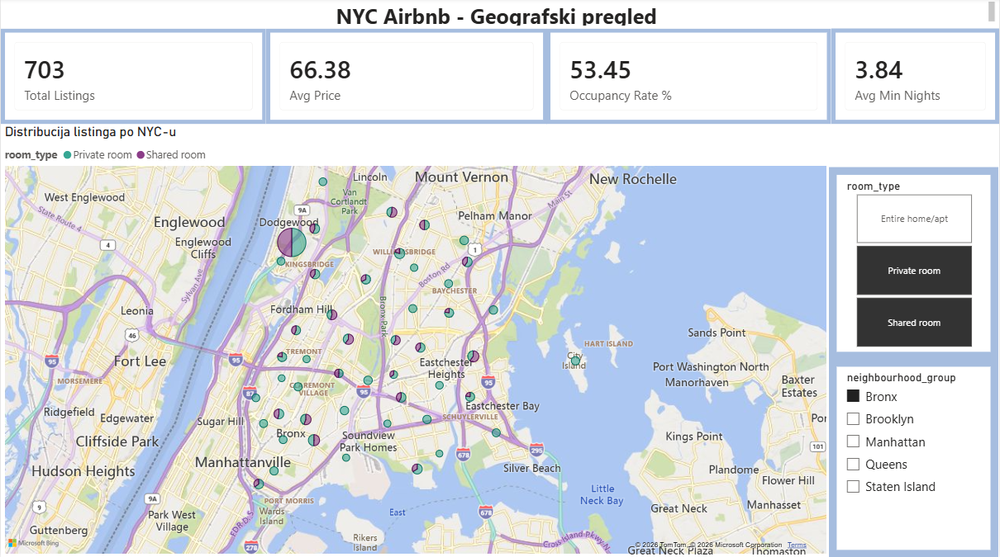
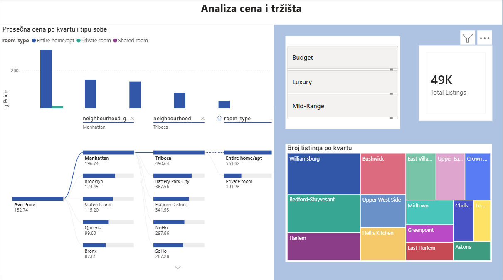
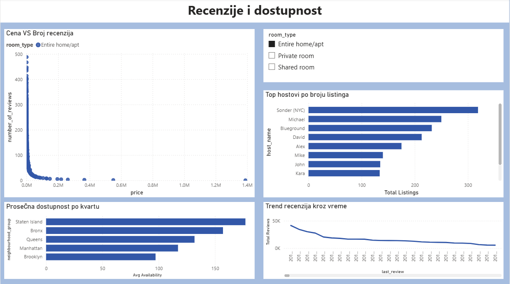

# NYC Airbnb Analysis — Power BI & Python

Analysis of ~49,000 Airbnb listings in New York City: an interactive Power BI report and a Python notebook with exploratory analysis and machine learning models.

Dataset: [New York City Airbnb Open Data (Kaggle)](https://www.kaggle.com/datasets/dgomonov/new-york-city-airbnb-open-data) — `AB_NYC_2019.csv`

## Research questions

1. Can we predict a listing's price from its characteristics? (regression)
2. Can we classify a listing into a price category — Budget, Mid-Range, Luxury? (classification)
3. What natural groups of listings exist? (clustering)

## Power BI report

Star-schema data model: `Fact_Listings` with `Dim_Location`, `Dim_RoomType` and `Dim_Host`.
DAX measures: Total Listings, Avg Price, Occupancy Rate %, Avg Availability, Avg Min Nights, Price Per Review.

| Page            | What it shows                                                                     |
| --------------- | --------------------------------------------------------------------------------- |
| Overview        | Price map, KPI cards, borough and room type slicers                               |
| Price analysis  | Avg price by borough and room type, listings by neighbourhood, decomposition tree |
| Reviews & hosts | Reviews over time, price vs. reviews, top hosts, availability by borough          |

## Python notebook

- **Data cleaning:** removed price outliers (price = 0 or > $1,000), filled missing `reviews_per_month`, label-encoded categorical features
- **EDA:** distributions by borough and room type, price distribution, correlation matrix

**Key finding:** median price of an entire home is $190 in Manhattan vs. $100 in the Bronx.

| Model                                     | Result                                                   |
| ----------------------------------------- | -------------------------------------------------------- |
| Linear Regression (price)                 | RMSE 99.53, R² 0.29                                      |
| Random Forest Regressor (price)           | RMSE 86.87, R² 0.46                                      |
| Random Forest Classifier (price category) | Accuracy 70.5%, weighted F1 0.705                        |
| K-Means clustering                        | k = 4, chosen with the elbow method and silhouette score |

## Tech stack

Python (pandas, NumPy, Matplotlib, Seaborn, scikit-learn), Jupyter Notebook, Power BI (DAX, data modeling)

## Author

Nikolina Azaševac — Information Systems Engineering, Faculty of Technical Sciences, University of Novi Sad
